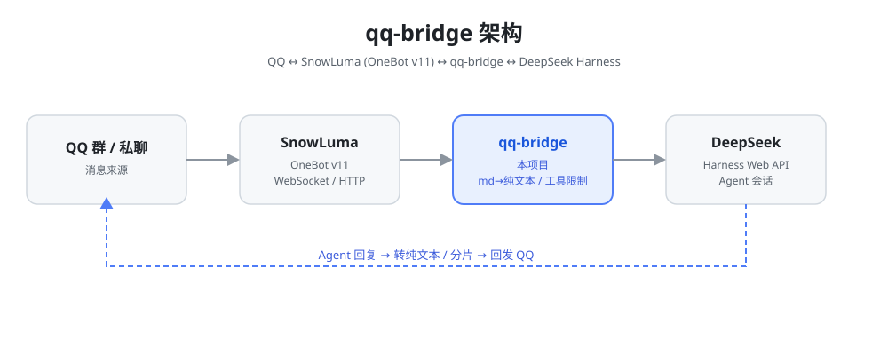

# QQ ↔ DeepSeek Harness 桥接

[](https://github.com/daifayan/qq-bridge/actions/workflows/ci.yml) [](LICENSE) [](package.json)

**English**: [README.en.md](README.en.md) | **中文**: [README.md](README.md)

> 📘 详细内外核说明书见 **[docs/PROJECT_GUIDE.md](docs/PROJECT_GUIDE.md)**（架构、数据流、配置全解、调试与改进指南）。
>
> 🔒 QQ 会话的权限边界与安全承诺见 **[RULES.md](RULES.md)**。
>
> 🧭 代码审查标准、风险分级和 PR 流程见 **[CODE_REVIEW.md](CODE_REVIEW.md)**。

把 QQ 消息接入 DSH agent：QQ 好友/群发来的消息会变成 DSH 会话里的用户消息，agent 的回复（含提问、工具审批）会发回 QQ。

> ⚠️ **当前版本 `v0.1.6`，实测兼容 DSH `0.1.5-rc.1` ~ `0.2.0-rc.2`**（含 DSH Desktop 桌面端内嵌内核，端口 `43129`）。使用 Cookie 鉴权、斜杠 RPC 和 `/api/remote.mux` 事件流；这一代协议自 DSH `0.1.2-alpha.1` 起引入，与更早的点号 endpoint 协议不兼容——**DSH `0.1.1-rc.2` 及更早**请改用 tag [`v0.1.0`](https://github.com/daifayan/qq-bridge/releases/tag/v0.1.0)。
>
> **桥接认协议、不认版本号**：启动时探测三个关键端点（`settings/describe`、`agentPresets/list`、`session/list`）确认协议在位，把探测结果与磁盘上的 DSH 版本一起写进日志和 `state/dsh-protocol.json`。连不上（等它起来）、鉴权失败（查 token）、协议不兼容（要改代码）三类问题分别出声，不会静默挂死。
>
> 默认分支 `master` **就是**本版本，`git clone` 直接拿到，无需切换分支。

```
QQ 消息 ──► SnowLuma（OneBot v11 WS）──► 本桥接进程 ──► DSH Web API (127.0.0.1:3080/api，桌面端 43129)
                                                ▲                      │
                                                └── agent 回复/提问/审批 ┘
```

## 项目展示



> 数据流：QQ 消息 → SnowLuma（OneBot v11）→ qq-bridge → DSH Web API；agent 的回复/提问/审批再经桥接转回 QQ。

## 架构

- **QQ 侧**：`@snowluma/sdk` 的 `SnowLumaWebSocketClient`（OneBot v11 WebSocket 客户端，自动重连）
- **DSH 侧**：适配 DSH 0.1.2 起、0.1.5 复核通过的协议——launch token 换 Cookie 鉴权、`/api/<namespace>/<method>` 斜杠 RPC、`/api/remote.mux` + `session/follow` 事件流；复用 `AbstractApiClient` 传输层但不再依赖旧版 zod value schema。会话模型由桥接按 `config.json` 的 `dsh.model` 逐会话 `session.selectModel` 固定（默认 `deepseek-flash` = DeepSeek-V41-Flash，多模态）
- **agent 自主收发 QQ**：DSH 的 MCP 客户端（`~/.dsh/profiles/web/cordis.patch.yml` 配置）接入三个 MCP server：
  - `snowluma`（桥接自带 `src/mcp-snowluma-safe.js`）：QQ 动作**安全子集**（查状态/查群/查消息/发消息/发语音，发送强制白名单；发送工具支持可选 `replyToMessageId` 引用回复；`qq_update_self_profile` 让 AI 记录"观察到的自己"）
  - `snowluma-host`（桥接自带 `src/mcp-host-server.js`）：`snowluma_status`（默认只读探活）；`start_snowluma` / `stop_snowluma` 需显式开启 `snowluma.allowProcessControl: true` 且仅在 `closed-agent` 模式可用
  - `web-search-safe`（桥接自带 `src/mcp-web-search-safe.js`）：只读 `web_search` / `web_fetch`（带 SSRF 防护），供 agent 查网络用语/资料
- **会话模型**：每个 QQ 会话（私聊/群）对应一个独立的 DSH 会话，统一归组到「QQ 聊天」工作区（不再散落未分组）；映射持久化在 `state/sessions.json`
- **性格定制**：QQ 会话默认使用 `qq-chat` agent preset（`~/.dsh/.agent-presets/qq-chat/agent.cordis.yml`），`reserved2` 使用 `qq-chat-v2`（`~/.dsh/.agent-presets/qq-chat-v2/agent.cordis.yml`）；人格与默认 DSH 一致（coding agent），仅附加 QQ 场景规则；**角色扮演**是可选机制——由控制台或管理端设置 `state/current-role.json` 注入（群友无法更改）
  - **切角色 = 换脑子**：每个角色一套独立的 `state/sessions.<角色>.json` / `state/social-v2.<角色>.json` / `state/self-profile.<角色>.md`，切换时不共享会话映射、社交状态和待办；无角色时退回无后缀的旧文件，老数据照常可用
  - **角色管理页** `http://127.0.0.1:<consolePort>/roles`：看每个角色的卡大小、会话/话题/印象数与状态文件体积，直接在页面上改角色卡（保存前自动备份成 `.bak-<时间戳>`）
  - **自我画像（L2）**：角色卡（L0）是管理员定的、AI 只读；`state/self-profile.<角色>.md` 是 AI 自己写"我发现自己是什么样"的地方，只增不删，注入排在角色卡之后，与角色卡冲突时以角色卡为准
- **本地控制台**：桥接自带 Web 控制台 `http://127.0.0.1:3100`——切换运行模式（chat / closed-agent / reserved / reserved2）、设置角色、静默开关、查看活动日志、修改管理员/控制台令牌，全部即时生效；访问需要令牌（`config.json` 的 `consoleToken`，未配置时自动生成并打印在启动日志；控制台内可手动修改或重新生成）
- **运行模式**：
  - `chat`：白名单群 + 白名单私聊 → qq-chat 安全聊天
  - `closed-agent`：仅私聊 owner（config.json 的 ownerQQ，可在控制台设置）→ 完整工具（默认用 DSH 自己声明的默认 preset，即 `standard`；可在控制台「closed-agent preset」下拉改为任意 DSH preset），可在 QQ 上操控 DSH
  - `reserved`（一代仿真）：仿真群友，观望/活跃/试探/退场状态机，选择性参与、按空格分句发送、主动收尾
  - `reserved2`（二代仿真，运行 `setup-dsh.mjs` 后 DSH 默认）：文本不自动转发，AI 通过 `qq_get_unread_messages` / `qq_send_message` 等工具自主看消息、发言、等待、设置唤醒/潜水；DSH 端使用 `qq-chat-v2` preset
- **交互增强**：
  - agent 通过 `ask_user_question` 提问时，问题会转发到 QQ，回复即自动应答
  - agent 请求工具审批时，转发到 QQ，回复「通过」/「拒绝」即可决策
  - 支持 DSH 斜杠命令（如 `/model`）与 `/reset`（重置会话上下文）
  - 群聊引用/回复会解析成「被引用人 + 原文」注入 DSH（如 `[引用 Derp：El Psy Kongroo是啥]机关的走狗`），让 AI 判断这句话是对谁说的，不会把群友之间引用第三方的对话误当成指向自己；引用机器人自己时会被视为必回
  - MCP 发送工具支持可选 `replyToMessageId`，并新增专用 `qq_reply` 工具：AI 可以先用 `qq_get_group_history` 拿到真实消息 id，再引用/回复某条消息（是否允许 AI 主动使用由人格/策略决定；桥接会检测发送类工具调用并自动跳过该回合的重复自动转发）
  - 一代仿真模式（`reserved`）下，AI 可以只输出 `[SILENT]` 表示“潜水/不接话”，桥接会静默不发送
  - 一代仿真模式（`reserved`）按空格分句：AI 用空格表示拆成多条消息；中英文/数字之间的空格也会被当成分条信号，不想分条就不要加空格（`reserved2` 不适用，分条请用 `qq_send_message` 数组）

## 前置条件

1. 运行中的 DeepSeek Harness（网页端默认 `http://127.0.0.1:3080`；**DSH Desktop 桌面端为 `http://127.0.0.1:43129`**）
2. 运行中的 SnowLuma，且配置好 OneBot WebSocket 与 HTTP API（默认 `ws://127.0.0.1:3001` / `http://127.0.0.1:3000`，`accessToken` 视配置填写）
3. Node.js ≥ 22.13

## 安装与配置

```bash
npm install        # 安装依赖（postinstall 会自动修补 @snowluma/sdk 的 ESM 打包 bug）
```

复制 `paths.bat.example` 为 `paths.bat`（用一键启动脚本前建议先配好；只跑 `npm start` 可不配）：

> Windows CMD 用户请用：`copy paths.bat.example paths.bat`

| 字段 | 说明 |
| --- | --- |
| `NODE` | node.exe 绝对路径（需 ≥22.13）；**填包内 `node-runtime\node.exe` 或系统 Node 均可**；留空则用 PATH 里的 `node` |
| `DSHBIN` | DSH 的 `lib/bin.js` 绝对路径；留空自动探测（从 `$DSH_HOME` 的 profiles 反查），一般不用填 |
| `DSHLNK` | 启动 DSH 的快捷方式（.lnk）或批处理 |
| `DSHOPEN` | 打开 DSH 页面并注入新 token 的脚本（可选） |
| `SNOWDIR` | SnowLuma 安装目录（自带 node.exe），**必填** |
| `BRIDGEDIR` | 本项目目录，留空即取脚本所在目录 |
| `LOGDIR` | 桥接/DSH 日志目录，留空默认 `../bridge-logs` |

复制 `config.example.json` 为 `config.json` 后编辑：

> Windows CMD 用户请用：`copy config.example.json config.json`

> ⚠️ 真实 `config.json` 与 `state/` 不会进入公开仓库，仓库只提供脱敏的 `config.example.json` 模板。

| 字段 | 说明 |
| --- | --- |
| `dsh.baseUrl` | DSH 地址，网页端默认 `http://127.0.0.1:3080`，DSH Desktop 桌面端用 `http://127.0.0.1:43129` |
| `dsh.provider` / `dsh.model` / `dsh.reasoningEffort` | DSH 会话使用的模型/推理强度；若你的 DSH 没有示例中的模型，改成 DSH 设置页里可用的模型即可（选择失败只打日志，不阻塞启动） |
| `dsh.authToken` | DSH launch token（新版 DSH 用于换取 Cookie 的进程启动 token）。留空时桥接会自动从 `~/.dsh/guard/logs/server-*.out.log` 发现；DSH 重启后遇到 401 也会自动重新发现并换 Cookie |
| `dsh.authHeader` / `dsh.authPrefix` | 保留字段，当前新版 DSH 链路使用 Cookie 交换，不再直接发送该鉴权头 |
| `snowluma.wsUrl` | SnowLuma OneBot **WebSocket** 地址（如 `ws://127.0.0.1:3001`） |
| `snowluma.httpUrl` | OneBot **HTTP API** 地址（如 `http://127.0.0.1:3000`）；不要填 WebSocket 端口，否则会报 HTTP 426 |
| `snowluma.accessToken` | OneBot accessToken，未配置留空 |
| `snowluma.launcherPath` / `homeDir` | SnowLuma 启动脚本与安装目录（供 agent 自动启动/停止） |
| `agentPreset` | QQ 会话使用的 DSH agent preset，默认 `qq-chat`（改性格见下文） |
| `socialV2.agentPreset` | `reserved2` 模式使用的 DSH agent preset，默认 `qq-chat-v2` |
| `workspaceTitle` | QQ 会话在 DSH 界面中的归组名称，默认「QQ 聊天」 |
| `allow.private` / `allow.groups` | 白名单（QQ 号/群号数组）；留空且 `allowAllWhenEmpty: true` 时放行全部 |
| `deny.*` | 黑名单，优先于白名单 |
| `ackMessage` | 消息投递后的立即回复，空字符串关闭 |
| `sendDelayMs` | QQ 连续发送间隔，防止触发频率限制 |
| `consolePort` | 本地控制台端口，默认 `3100` |
| `consoleToken` | 控制台访问令牌；留空时启动自动生成并保存到 `state/console-token` |

> ⚠️ `allowAllWhenEmpty: true` 表示「白名单没填就全部放行」——把 agent 接入 QQ 等于把账号控制权交给了模型，建议先填白名单。

### 语音回复（可选）

桥接可以给文字回复**额外补一条语音**，让鲸鲸用声音回你。本地推理，**不联网、不依赖 Edge TTS**（微软 2026-10-23 起已全局掐掉第三方 Edge TTS）。

- **引擎**：`sherpa-onnx-node` + Piper 中文模型 `vits-piper-zh_CN-xiao_ya-medium-int8`（已放在 `models/` 下，约 20MB，纯 CPU，本机 i5-6400 实测约 1.6x 实时）。
- **开启**：`config.json` 里 `voice.enabled = true`，`voice.scope` 选范围：
  - `off` 关闭；`owner` 只对 `ownerQQ` 本人；`private` 对所有私聊；`all` 私聊+群。
- **策略**（`src/voice-policy.js`，纯函数好测）：短句 + 情绪浓的回复更容易补语音；受 `maxChars`/`minChars` 长度门控、`cooldownMs` 同会话冷却、`hourlyCapPerConv`/`dailyCap` 配额、`quietHours` 静音时段约束。判定是概率性的，不是每条都发。
- **去重（关键）**：`voice.replaceText`（默认 `true`）开启时，会发语音的那条回复就**不再发同样的文字**——你只收到语音、不重复收文字。设 `false` 才退回「文字 + 语音」双发（旧行为）。因为语音只在短句（≤ `maxChars`）时触发，替代不会丢长内容。
- **文本清洗**（`src/tts-text.js`）：去掉 Markdown 记号、代码块、链接地址、括号里的动作提示（如「（小声）」），数字转中文读法，避免念出奇怪内容。
- **失败不静默**：合成或发送任一步出错，只降级成纯文字，并在日志 + 控制台活动里明确报「语音未发出」及原因。

#### 调音台：不换模型也能改音色（2026-10-31）

`voice.tone` 段 + `/voice-lab` 页面。**不改模型，只改输出**，所以不用下新模型、不占额外内存：

- **半音变调**（`voice-tone.js`）：让模型按 `1/r` 的语速念，再把波形按 `r` 重采样 —— 时长基本不变、音高变 r 倍，共振峰跟着上移（所以正数是"更幼"）。时间伸缩交给神经网络做，比 OLA/WSOLA 干净。
- **情绪映射**：复用 `voice-policy.js` 的 `emotionScore`，把一句话归到 `calm / normal / soft` 三档，每档可单独偏移音调/语速（也能指定音色号 `sid`，留给以后的多音色模型）。
- **音量**：乘增益 + 软限幅，推很猛也不爆音。
- **语气词**：从词库随机挑一个垫在正文前面（"诶嘿" + 正文），词条也用同一个模型念、走同一份缓存，音色自然一致。
- **生效时机**：音调/语速/音量/情绪/语气词是**每句现读** `cfg.voice.tone`，改完保存立即生效；只有换模型目录/引擎要重启桥接。

```bash
npm run test:voice-tone                      # 调音 DSP 单测（22 项，不加载模型）
node scripts/preview-tone.mjs --batch        # 生成一组变调对比样本到 state/tone-preview/
node scripts/preview-tone.mjs "你好呀" --pitch 2 --speed 1.05
```

界面上：控制台「11 语音设置」和启动器语音面板底部都有「打开语音调音台」入口（启动器会把控制台令牌拼进地址，点开即用），
也可以直接访问 `http://127.0.0.1:<consolePort>/voice-lab`（要带控制台令牌）。左边试听、右边调参，拖动滑杆自动试听，`Ctrl/⌘+Enter` 试听、`Ctrl/⌘+S` 保存。

#### 让模型自己决定发语音（2026-10-31）

上面那套是**桥接掷骰**决定要不要补语音。另外模型也可以自己调 `qq_send_voice` 主动发一条：

- **只跳过掷骰，不跳过规矩**：`rand` 恒 0 表示"模型要发就发"，但冷却、每小时/每日上限、字数、静音时段、目标范围检查全部复用 `voice-policy.js` 的同一套判定 —— 超了直接返回原因，模型该改发文字。
- **不会语音+文字双份**：用语音替代文字时那条计入 `sent` 并标 `voiced`；紧接着的 `qq_send_message` 若与 60s 内刚说过的语音内容重复，直接 409 拒掉。
- **开关**：`socialV2.tools.sendVoice: false` 可关掉这个工具；`voice.enabled: false` 时接口整体不可用。

快速验证（不依赖真实聊天）：

```bash
node scripts/test-voice-policy.mjs   # 策略单测
node scripts/say.mjs "想试听的一句话"  # 直接给 ownerQQ 发一条语音
node scripts/test-voice-e2e.mjs      # 复刻生产 maybeSendVoice 全链路，真实发一条到 QQ
```

> 想换声音/换引擎（如接外部 TTS 服务），改 `voice.engine` 与 `voice.local` / `voice.http` 段，详见 `config.example.json` 的 `voice` 模板。

### 视频分镜（可选）

QQ 视频以前只渲染成 `[视频]` 占位，模型看不见内容。开启后，桥接收到视频会产出**一张宫格图 + 一份带时间码的清单**，比逐帧抽图省 token，比只喂字幕看得多。

- **依赖**：`dsh-video-storyboard` 插件 + `ffmpeg`/`ffprobe`（默认搜索 `~/.dsh/tools/ffmpeg/bin/`，不改系统 PATH）。
- **开启**：`config.json` 的 `video.enabled = true`。
- **参数**：`cells`（宫格数，`0` = 让插件按画面密度自己决定，也接受 4/6/9）、`maxBytes`（单视频下载上限，默认 40MB）、`timeoutMs`（单次分镜总时限）、`keepDays`（产物保留天数）、`maxTextChars`（清单进上下文的字数上限）。
- **台词**：`video.transcript = "auto"` 时走本机离线 ASR（OpenAI 兼容转写接口，不联网不花钱）；`"off"` 只出画面。
- **边界**：一条消息**只解析第一个视频**；超限或失败退化成一行说明文字，不静默吞掉。

```bash
node scripts/test-video-storyboard.mjs "某个视频.mp4"   # 配置 → CLI → ffmpeg → 实跑
```

> 详细说明与排错见 `docs/视频分镜-说明.md`。

### QQ 指令（本机干活，可选）

管理员私聊发「指令 …」，桥接把它交给一个**独立的 `standard` 会话在本机执行**，结果回私聊，并记到 `state/pc-jobs.jsonl`。

- **开启**：`config.json` 的 `pcJobs.enabled = true`；`pcJobs.prefix` 是触发前缀（默认 `指令`，`/pc` 和 `#` 始终可用）。
- **安全边界（桥接层卡死，不靠提示词）**：只认 `ownerQQ` + 只认私聊。群聊会话**永远**没有本机工具，群友说服 AI 也没用。
- **工作目录**：`pcJobs.cwd`；会话用 `pcJobs.preset` 指定的 preset。
- 改 `enabled` / `prefix` **立即生效**（每次判定现读配置），不用重启。

### DSH 端安装（必做：装 preset + 挂 MCP）

桥接和控制台能跑起来还不够，DSH 端还需要安装两个聊天 preset（`qq-chat` / `qq-chat-v2`）并挂载 MCP。**单机新装同样必须执行这一步**（不是只有「另一台设备」才需要），装完还要**重启 DSH**：

```bash
node scripts/setup-dsh.mjs
```

> 全新环境下脚本会把 DSH 默认模式设为 **`reserved2`（二代仿真）**，并创建本地 `state/mode.json` 兜底；这样 AI 使用 `qq_send_message` 等工具收发消息时，DSH 会自动使用 `qq-chat-v2` 模式。如果本机已存在旧的 `state/mode.json` 或 DSH 设置值，脚本会保留不覆盖。之后可在**桥接控制台**（默认 `http://127.0.0.1:3100`）顶部按钮切换模式，控制台会同时写入 DSH 设置与本地兜底文件。

详细步骤见 **[docs/DSH_SETUP.md](docs/DSH_SETUP.md)**。

## 完整启动流程（从零开始）

共 6 步。DSH 已安装并运行，缺的是 SnowLuma 本体 + 桥接侧的 DSH 端安装（**第 2、3 步最容易漏，漏了 QQ 上会毫无反应**）：

1. **DSH**（已运行，无需操作）
   确认 `http://127.0.0.1:3080`（桌面端 `43129`）能打开即可。

2. **装桥接并复制配置**
   ```bash
   git clone https://github.com/daifayan/qq-bridge.git
   cd qq-bridge
   npm install
   ```
   Windows CMD 用 `copy config.example.json config.json`，其他平台用 `cp config.example.json config.json`。
   **示例模板里 `allow.private` / `allow.groups` 是空数组**——空白名单 + `allowAllWhenEmpty: false` 时桥接不响应任何消息（这是刻意的 fail-closed 默认值）。白名单在第 5 步填。

3. **装 DSH 端（preset + MCP），然后重启 DSH**
   ```bash
   node scripts/setup-dsh.mjs
   ```
   装完**必须重启 DSH**——preset 与 MCP 只在 DSH 启动时加载。
   跳过这步桥接不会崩，但群聊会话拿不到 `qq-chat` preset，桥接会**拒绝建会话**（有意的安全设计：绝不回退到带 bash/文件工具的默认 preset），表现同样是 QQ 上没反应。

4. **下载并解压 SnowLuma**
   - 下载：<https://github.com/SnowLuma/SnowLuma/releases/latest> 选 `SnowLuma-v<版本>-win-x64.zip`（完整版，自带 Node 运行时；Lite 版需本机 Node 22.13+）
   - 解压到任意目录（例如 `C:\SnowLuma`），双击 `launcher.bat`

5. **首次引导（WebUI）+ 填写桥接配置**
   - 打开启动日志里的 WebUI 地址（README 写的是 `http://localhost:5099`，以你启动日志里实际打印的为准）
   - 用**启动日志中的初始密码**登录，按引导：同意条款 → 设置密码 → 接入 QQ 进程（扫码登录）
   - 在 WebUI 里配置 OneBot 连接：开启 **WebSocket 服务端** 和 **HTTP API**，分别记下**端口**（默认 WS `3001`、HTTP `3000`）和 **accessToken**（若配置了）
   - 回到 `config.json` 填好 `snowluma` 段，并把 `allow.private` / `allow.groups` 换成**你自己的 QQ 号 / 群号**：

     ```json
     "snowluma": {
       "wsUrl": "ws://127.0.0.1:3001",
       "httpUrl": "http://127.0.0.1:3000",
       "accessToken": "你在 WebUI 里配置的 token（没配置就留空）"
     }
     ```

   `wsUrl` 是 OneBot **WebSocket** 端口，`httpUrl` 是 OneBot **HTTP API** 端口（不要填成同一个 WS 端口，否则 MCP 工具会报 HTTP 426）。

6. **启动桥接**
   ```bash
   npm start          # 前台运行（崩溃不自动重启）
   ```
   看到 `SnowLuma 已连接` 即成功；然后 QQ 上给机器人账号发条消息测试。
   Windows 想要「崩溃自动重启」请改用 `start.bat`（见下节）。

## 运行与运维

```bash
npm start          # 或双击 start.bat（守护模式：崩溃自动重启，关闭窗口即停止）
```

**⚠️ 重要**：
- **桥接只能运行一个实例**（有单实例锁，重复启动会被拒绝并提示"已有实例在运行"）
- **用 start.bat 启动**（守护模式），窗口别关——桥接崩溃会在 5 秒后自动拉起
- 桥接异常/消息无反应时：双击 `restart.bat`（自动杀旧实例 → 清理锁 → 重新启动守护）
- **重启 DSH 通常不需要动桥接**：每 5 秒探活，DSH 不可用期间收到的 QQ 消息在桥接进程内排队（最多 50 条/会话，满后丢最旧项），恢复后尝试补投。桥接进程退出会丢失内存队列；断线期间已经结束的回复暂不保证补发。
- 修改 `config.json` / `roles/` / `state/current-role.json` 后重启桥接生效；修改 `~/.dsh/.agent-presets/qq-chat*/` 或 MCP 配置后重启 DSH 生效
- **QQ 必须先登录**：雪露是挂在已登录的 QQ 进程上的，QQ 没开时启动套件只会得到一串「3000 端口不通」。Windows 上 `启动桌面端套件.bat` 会先跑 `scripts/ensure-qq.mjs`，按 `paths.bat` 里的 `QQEXE` 自动把 QQ 拉起来（登录仍需人工扫码）；`QQEXE` 留空则跳过这一步
- 语音（发不发/频率/上限）、模型目录、引擎、视频分镜的配置在桥接**启动时**快照进实例，改完要重启桥接；
  `voice.tone`（音调/音量/情绪映射/语气词）和 `pcJobs` 的开关前缀是**每次现读**的，立即生效

日志示例：

```
12:00:01 [bridge] SnowLuma 已连接：ws://127.0.0.1:3001
12:00:02 [bridge] 新会话 private:12345678 -> sess_xxxx
12:00:02 [bridge] 已投递 private:12345678: 你好
12:00:20 [bridge] agent 回复 (private:12345678) 42 字
```

## 自测（不需要 SnowLuma / QQ）

离线回归（使用临时目录和模拟服务，不读取真实配置、不发 QQ 消息）：

```bash
npm run test:audit
```

本轮审查与修复明细见 [docs/AUDIT_REPORT_2026-09-18.md](docs/AUDIT_REPORT_2026-09-18.md)。升级后会为没有权限元数据的历史映射重建一次 QQ 会话；模式或 preset 变化也会自动重建，避免保留旧权限。旧历史仍在 DSH 中。

验证 DSH 侧链路是否打通（会创建一个独立测试会话，不影响现有会话）：

```bash
npm run self-test
```

预期输出：连接成功 → 测试会话创建 → prompt 被接受 → 打印 agent 回复。

## 目录结构

```
qq-bridge/
  config.example.json   # 配置模板（脱敏占位符；真实 config.json 不入库）
  docs/
    PROJECT_GUIDE.md    # 公开版项目说明书
  dsh/agent-presets/    # qq-chat / qq-chat-v2 的 DSH agent preset 模板
  launcher/             # 「鲸鲸控制台」桌面启动器（127.0.0.1:3120，Edge --app 窗口）
    server.mjs          # 本地服务：服务状态、动作执行、配置读写 HTTP 层
    ui.html             # 界面：卡片式动作 + 模型/语音/视频/指令/白名单面板
    config-ops.mjs      # 配置读写层：读 → 校验 → 备份 → 写 → 重启桥接
  plugins/qq-mode-console  # DSH 插件：注册 qq-mode 设置命名空间（仅 host 半，UI 卡片未实现）
  public/console.html   # 桥接控制台网页（3100，可被 launcher 用 iframe 内嵌）
  public/roles.html     # 角色管理页（/roles）：角色卡大小、状态统计、在线改卡
  src/
    bridge.js           # 主程序
    dsh-client.js       # Node 版 DSH API 客户端（WS 下行）
    md-to-plain.js      # Markdown → QQ 纯文本
    tts.js / tts-text.js / voice-policy.js  # 本地 TTS、文本清洗、发声策略
    video-storyboard.js # 视频分镜：落盘 → 调 CLI → 收宫格图 + 清单
    self-test.js        # DSH 侧自测
  scripts/              # 测试/运维脚本（含 postinstall 的 patch-snowluma-sdk.mjs）
    patch-snowluma-sdk.mjs  # 修补 SDK 的 ESM 打包 bug（postinstall 自动执行）
    ensure-qq.mjs       # QQ 没开就拉起来（雪露只能挂到已登录的 QQ 上）
    probe-console-dom.mjs   # 控制台面板 CDP 自检（SSE 下截图不可靠）
  state/                # 运行时数据（不入库）
```

## 已知限制

- agent 回复在回合结束时一次性发送（不做流式逐字转发）；回复超过 4000 字自动分段
- 图片、语音、视频都可以接入多模态模型；无法取得字节的消息（如过期链接）仍使用占位文本
- 视频分镜一条消息只解析第一个视频；离线 ASR 需要本机配好转写服务，没配好时台词退化为空
- agent 的 Markdown 回复会转成纯文本（链接保留 `文字 (url)` 形式）
- `@snowluma/sdk` 的 npm 发布版存在 ESM 扩展名 bug，本仓库通过 postinstall 补丁修复（见 `scripts/patch-snowluma-sdk.mjs`）
- 桌面启动器（`launcher/`）的若干按钮会调用 `../tools/` 下的脚本，那部分不在本仓库内，换机器时需要一并搬过去

## 合规提醒与风险声明

**账号风险（请务必阅读）**

- SnowLuma 是独立第三方项目，与腾讯/QQ 无隶属关系。它通过**非官方协议**接入 QQ，**不在腾讯授权范围内**。
- 使用非官方客户端存在**被风控、限制登录甚至封号**的风险；本项目不对此承担任何责任。**请勿在你不愿失去的账号上使用。**
- 「仿真群友」相关能力（主动开话题、按时机潜水/唤醒、收藏表情等）恰好是 QQ 风控较敏感的行为特征，触发风险更高；如无必要请关闭。
- 使用前请阅读 SnowLuma 的 EULA 与《QQ 用户协议》，并遵守你所在地区的法律法规。本项目仅供学习与技术研究。

**数据与隐私**

- 群聊/私聊文本会发送给所配置的模型服务（默认 DeepSeek）用于生成回复。
- 部分数据会**保存在本机**：会话映射（`state/sessions.json`）、黑话学习证据、活动日志等。
- 访问边界由 `config.json` 的 `allow.private` / `allow.groups` 白名单控制；**白名单配错会导致不该接入的群内容进入模型或日志**。不要把你不信任的群加进白名单。

**免责**

本项目按「原样」提供（MIT），不附带任何担保。因使用本项目导致的账号封禁、数据泄露、服务中断或其他后果，作者不承担责任。
